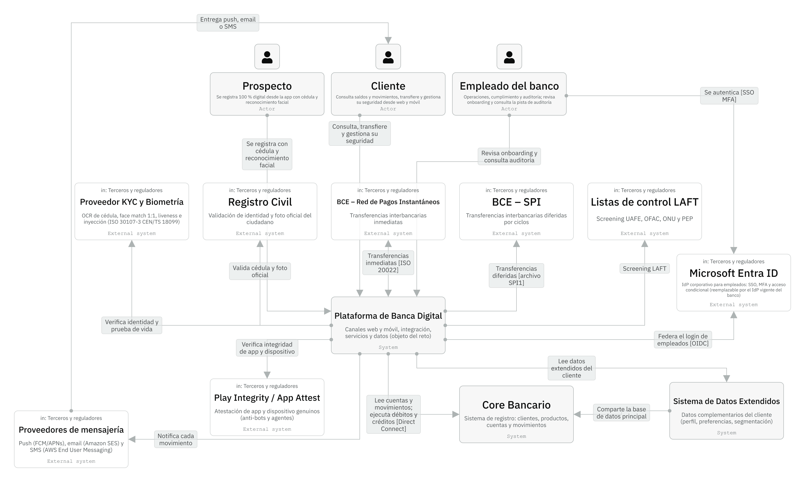
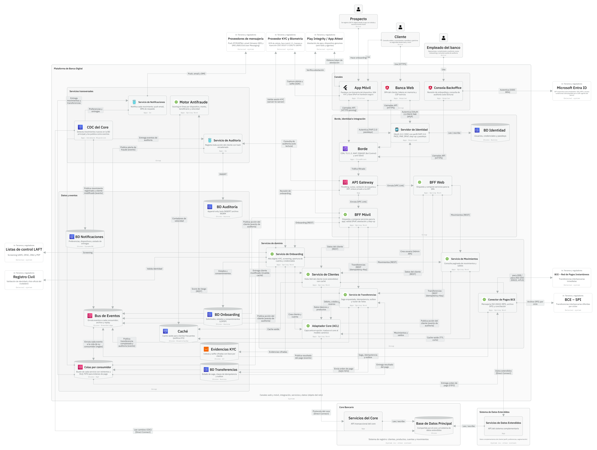
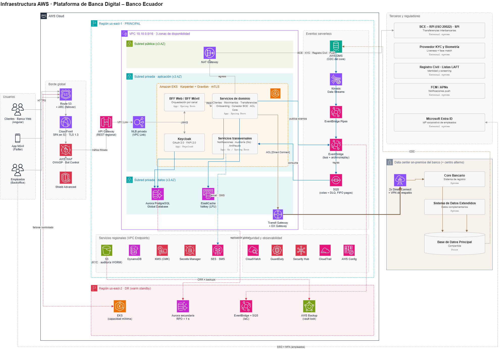

# Digital Banking Platform · Arquitectura de Banca Digital – Banco Ecuador

Propuesta al **reto técnico de Arquitecto de Soluciones**: arquitectura de una plataforma de banca digital (web y móvil) para consultar movimientos, hacer transferencias propias e interbancarias y registrar nuevos clientes con reconocimiento facial.

**Modelo C4 en IcePanel:** [https://s.icepanel.io/8it5iVKhNeTy2G/qBcE](https://s.icepanel.io/8it5iVKhNeTy2G/qBcE)

## Resumen ejecutivo

| Tema | Decisión |
|---|---|
| Cloud | **AWS** us-east-1 (principal) + us-east-2 (DR); EKS, Aurora, ElastiCache. |
| Integración | **Amazon API Gateway** → **BFF Web / BFF Móvil** (Spring Boot WebFlux) → microservicios hexagonales. |
| Transferencias | **Saga orquestada** + idempotencia + outbox; rieles: core (propias), **BCE Pagos Instantáneos (ISO 20022)** y **SPI**. |
| Eventos | **EventBridge + SQS** (serverless); cambios del core capturados con **AWS DMS**. |
| Identidad | OAuth 2.0 **Authorization Code + PKCE** con perfil **FAPI 2.0**; **Keycloak** para clientes y **Entra ID** para empleados (reemplazables por el IdP vigente de la organización). |
| Onboarding / biometría | KYC con prueba de vida certificada y validación con el Registro Civil; acceso diario con **passkeys** (huella o Face ID). |
| Notificaciones | **Push + Email**, SMS de respaldo; cubren **todo** movimiento del core. |
| Auditoría | Base de solo inserción con hash encadenado + **S3 Object Lock (WORM)**. |
| Caché | **Cache-Aside** con ElastiCache Valkey (LFU) para clientes frecuentes. |
| Frontend | **Angular** (web) + **Flutter** (móvil); alternativa evaluada: React + React Native. |
| DR | Niveles T0–T3; T0 con RPO≈0 y RTO ≤ 15 min. |

## Diagramas

> 🔗 **Modelo C4 interactivo en IcePanel:** https://s.icepanel.io/8it5iVKhNeTy2G/qBcE  
> Permite navegar los tres niveles (contexto → contenedores → componentes) y ver el detalle de cada elemento.

### C4 · Nivel 1 – Contexto

### C4 · Nivel 2 – Contenedores

### C4 · Nivel 3 – Componentes
| Contenedor | Diagrama |
|---|---|
| BFF Móvil (orquestación) | [03-componentes-bff-movil.png](c4/diagramas/03-componentes-bff-movil.png) |
| Servicio de Transferencias | [03-componentes-transferencias.png](c4/diagramas/03-componentes-transferencias.png) |
| Servicio de Clientes (caché) | [03-componentes-clientes-cache.png](c4/diagramas/03-componentes-clientes-cache.png) |
| Servicio de Auditoría | [03-componentes-auditoria.png](c4/diagramas/03-componentes-auditoria.png) |

### Infraestructura AWS

## Entregables

| Entregable | Archivo |
|---|---|
| Modelo C4 (contexto, contenedores, componentes) | [IcePanel – modelo interactivo](https://s.icepanel.io/8it5iVKhNeTy2G/qBcE) · diagramas exportados en [`c4/diagramas/`](c4/diagramas/) |
| Diagrama de infraestructura | [`infra/infraestructura-aws.png`](infra/infraestructura-aws.png) (fuente editable: [`infra/infraestructura-aws.drawio`](infra/infraestructura-aws.drawio)) |
| Justificaciones de diseño | [`docs/01-justificaciones.md`](docs/01-justificaciones.md) |
| Consideraciones técnicas | [`docs/02-consideraciones-tecnicas.md`](docs/02-consideraciones-tecnicas.md) |
| Decisiones de arquitectura (ADR) | [`docs/adr/`](docs/adr/README.md) |

## Supuestos

Banco de tamaño mediano. El **core es genérico y on-premise**, junto con el sistema complementario y la base de datos principal. El core sigue siendo la fuente de verdad de saldos y movimientos.

## Editar el diagrama de infraestructura

Abrir `infra/infraestructura-aws.drawio` en [diagrams.net](https://app.diagrams.net) o en VS Code (extensión *Draw.io Integration*) y exportar como `infra/infraestructura-aws.png`.
