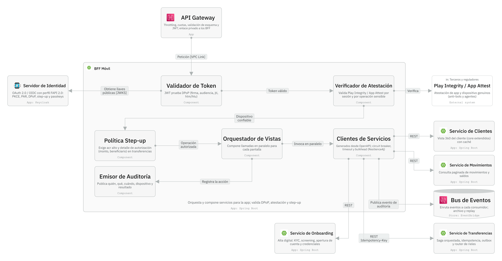
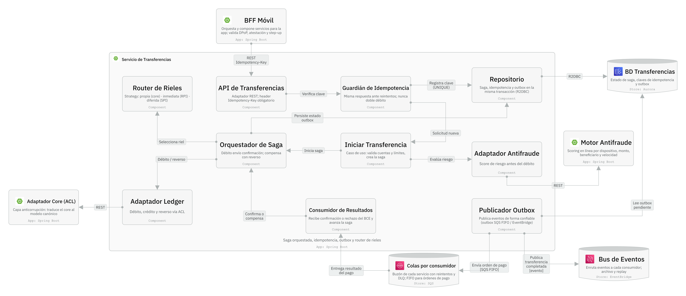
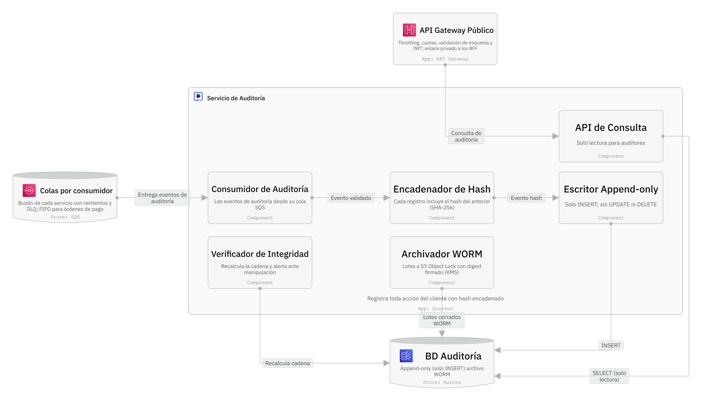
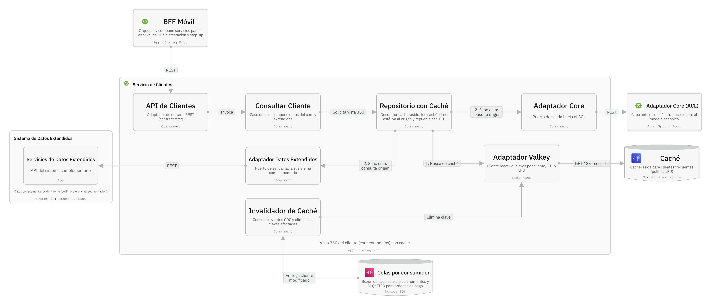

# 01 · Justificación de decisiones de diseño

> Documento breve con las decisiones principales: **qué** se eligió, **por qué** y **qué se descartó**. El detalle de implementación se trabaja en la fase de diseño detallado. Las decisiones formales están en [`adr/`](adr/README.md) y los términos menos comunes en el [glosario](03-glosario.md). El modelo C4 navegable está en [IcePanel](https://s.icepanel.io/8it5iVKhNeTy2G/qBcE).

## Supuestos

- El banco es **mediano** (tipo cooperativa grande o banco no sistémico).
- El **core bancario es genérico** y está **on-premise**, junto con el sistema complementario y la base de datos principal. Es lo habitual en Ecuador.
- La plataforma **no reemplaza el core**: el core sigue siendo la fuente de verdad de saldos y movimientos.

---

## 1. Capa de integración: API Gateway + BFF

- **Amazon API Gateway** resuelve lo transversal: throttling, cuotas, validación de contrato y token, y enlace privado hacia los servicios.
- La **orquestación vive en un BFF por canal** (*Backend for Frontend*: BFF Web y BFF Móvil, en Spring Boot WebFlux). Un gateway no debe contener lógica de negocio.
- Servicios que orquesta: **Clientes**, **Movimientos** y **Transferencias**, como pide el reto. Se agregan cinco justificados:
  - **Onboarding**, para el alta digital.
  - **Conector de Pagos BCE**, que aísla la mensajería del Banco Central.
  - **Adaptador del Core (ACL)**, una capa anticorrupción que protege al resto del sistema del modelo del legado.
  - **Notificaciones** y **Auditoría**, que exige el reto.
- Todos los servicios siguen **arquitectura hexagonal**: cambiar el core o un proveedor solo cambia un adaptador.

## 2. Transferencias

- **Saga orquestada:** una transferencia interbancaria cruza el core y el BCE, y no existe una transacción única que los abarque. La saga registra cada paso y, si algo falla, **compensa con un reverso**.
- **Idempotencia** (header `Idempotency-Key`): si el cliente reintenta, **nunca se debita dos veces**.
- **Transactional Outbox:** el cambio de estado y el evento se guardan juntos, así ningún evento se pierde.
- **Router de rieles** (patrón Strategy):
  - transferencias **propias**, en el core;
  - **inmediatas**, por la Red de Pagos Instantáneos del BCE con mensajería **ISO 20022**;
  - **diferidas**, por el **SPI**.

## 3. Autenticación y autorización

**Flujo recomendado:** OAuth 2.0 **Authorization Code + PKCE**, bajo el perfil **FAPI 2.0**, el estándar de Open Banking y Open Finance:

- **PAR:** los parámetros de autorización viajan por un canal seguro, no por el navegador.
- **DPoP:** el token queda ligado al dispositivo. Si lo roban, no sirve en otra máquina.
- **Step-up:** las transferencias exigen reautenticación fuerte.
- **Atestación de app** (Play Integrity / App Attest) y WAF con Bot Control, contra bots y automatización con IA.

**Proveedores de identidad**

| Usuarios | IdP | Por qué |
|---|---|---|
| **Clientes** | **Keycloak** (open source, en EKS) | Soporta FAPI 2.0, DPoP y passkeys. Sin costo de licencia por usuario. |
| **Empleados** | **Microsoft Entra ID** | Es el IdP corporativo más difundido en la banca ecuatoriana: SSO, MFA y acceso condicional. |

> Ambos IdP son **reemplazables por el que la organización ya tenga vigente**, después de evaluar su capacidad de crecimiento, su soporte de estándares (FAPI 2.0, passkeys), el costo de licenciamiento y la continuidad del proveedor. La arquitectura solo depende de OIDC y OAuth 2.0, no de un producto.

**Descartados:** Amazon Cognito (soporte limitado de FAPI 2.0 y poco adoptado en banca) y contraseña + SMS OTP (no es resistente a phishing).

## 4. Onboarding y biometría (dos momentos distintos)

| Momento | Solución | Herramientas de industria |
|---|---|---|
| **Onboarding** (una sola vez) | Foto de la cédula + selfie con **prueba de vida**, **comparación facial** contra la foto del **Registro Civil**, screening **LAFT** (UAFE, OFAC) y consentimientos **LOPDP** | FaceTec, Facephi o iProov, certificados **ISO 30107-3** (ataques de presentación: fotos, máscaras) + **CEN/TS 18099** (ataques de inyección: deepfakes) |
| **Acceso diario** | **Passkeys (FIDO2)** desbloqueadas con **huella o Face ID**; usuario + contraseña + OTP como respaldo | Biometría del propio sistema operativo (iOS / Android). La huella **nunca sale del teléfono**. |

## 5. Notificaciones

| Canal | Rol |
|---|---|
| **Push** (FCM / APNs) | Principal: canal cifrado hacia la app, inmediato y de bajo costo. |
| **Email** (Amazon SES) | Principal: deja un registro para el cliente. |
| **SMS** | Respaldo: solo si el push no llega, y **sin enlaces** para evitar fraudes por SMS. |

**Clave:** los avisos se disparan desde los **cambios en la base del core** (CDC con AWS DMS), no solo desde la app. Así se notifica **todo** movimiento, incluidos los de cajero y ventanilla, como exige la normativa.

## 6. Eventos asíncronos: EventBridge + SQS

- **Amazon EventBridge** recibe los eventos ("transferencia completada", "movimiento registrado") y los entrega a cada interesado. Además **archiva y re-envía** eventos si hace falta reprocesar.
- **Amazon SQS** es el buzón de cada servicio: si un servicio está caído, el mensaje lo espera, con reintentos y cola de errores. Las órdenes de pago usan **cola FIFO**, que garantiza el orden.
- **Por qué no Kafka:** exige operar un clúster dimensionado para grandes volúmenes. Para una cooperativa conviene lo **serverless y administrado**, que se paga por uso.

## 7. Auditoría y caché

**Auditoría:**
- Cada acción del cliente (quién, qué, cuándo, desde qué dispositivo y con qué resultado) se publica como evento.
- Un servicio liviano en **Go** la guarda en una base **solo de inserción** con **hash encadenado**, para que cualquier manipulación sea detectable.
- Se archiva en **S3 Object Lock (WORM)**, un almacenamiento que no se puede modificar ni borrar.
- *Amazon QLDB se descarta porque AWS ya no le da soporte.*

**Caché para clientes frecuentes:**
- **Cache-Aside** implementado como **Decorator** sobre el repositorio: el dominio no sabe que hay caché.
- **ElastiCache (Valkey)** con política **LFU**: los clientes que más consultan se quedan en caché sin lógica extra.
- La caché se invalida con los eventos de cambio del core.
- **El saldo disponible no se cachea.**
- **Componentes involucrados:** API de Clientes → caso de uso → repositorio con caché → adaptador Valkey / adaptadores del core → invalidador.

## 8. Frontend: 2 opciones evaluadas

| | **A. Angular + Flutter (elegida)** | B. React + React Native |
|---|---|---|
| **Fortalezas** | Angular: estructura definida, TypeScript obligatorio y seguridad integrada (protección XSS, CSP). Es muy usado en banca. Flutter: compila a código nativo y es fuerte en fintech. | El ecosistema y la oferta de talento más grandes. Un solo lenguaje (TypeScript). |
| **Desventajas** | Curva de aprendizaje alta. Dos lenguajes (TypeScript y Dart). | Menos estructura: más decisiones por equipo y riesgo de inconsistencia. |

**Por qué A:** la banca en línea es una aplicación **transaccional detrás de un login**, donde pesan más la consistencia y la seguridad que la flexibilidad. La desventaja de los dos lenguajes se mitiga con **contract-first**: los contratos OpenAPI generan los clientes de web y móvil.

## 9. Patrones aplicados

Arquitectura hexagonal · Backend for Frontend · Anti-Corruption Layer · Saga · Transactional Outbox · Idempotent Receiver · Strategy · Cache-Aside + Decorator · Change Data Capture · Circuit Breaker / Retry / Timeout · Publish-Subscribe.
