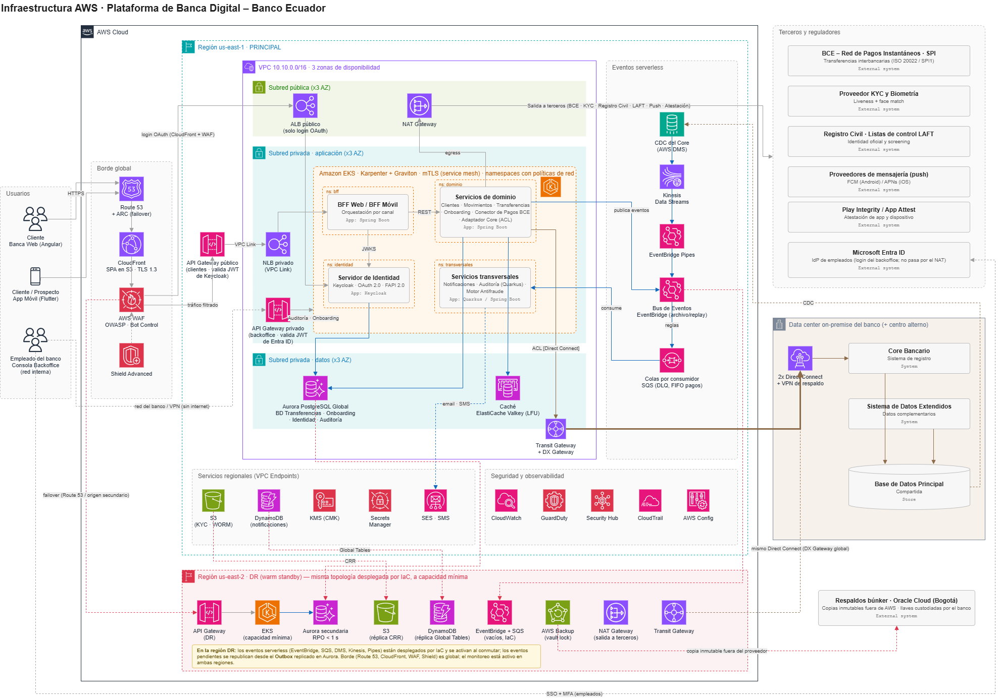

# 02 · Consideraciones técnicas

## 1. Normativa

| Norma | Cómo se atiende |
|---|---|
| **LOPDP** y su Reglamento | Hay consentimientos por finalidad, minimización de datos y atención de derechos. AWS actúa como **encargado del tratamiento** mediante contrato y cláusulas tipo. La SPDP aclaró que un encargado fuera del país no convierte, por sí solo, el tratamiento en transferencia internacional. |
| Derecho de supresión | **Cifrado con una llave por cliente** (AWS KMS). Destruir la llave deja sus datos ilegibles, incluso en respaldos que no se pueden modificar. |
| **Superintendencia de Bancos**: riesgo operativo, ciberseguridad y continuidad | Plan de continuidad con objetivos de recuperación (RTO/RPO) por nivel, pruebas periódicas de DR, gestión de proveedores críticos y monitoreo 24/7. |
| **Banco Central del Ecuador**: SPI y Red de Pagos Instantáneos | Conector dedicado con mensajería **ISO 20022** y conciliación diaria. |
| **LAFT / UAFE** | Screening en el onboarding y monitoreo antifraude de las transacciones. |
| **PCI-DSS v4.0.1** | Aplica solo si se manejan datos de tarjeta. Se reduce el alcance con **tokenización**: el número de tarjeta nunca llega a la plataforma. |
| ISO/IEC 27001 | Marco del sistema de gestión de seguridad de la información (SGSI). |

## 2. Alta disponibilidad y tolerancia a fallos

- **Multi-AZ** en todos los componentes: EKS, Aurora y ElastiCache se reparten en 3 zonas de disponibilidad. EventBridge y SQS son regionales por diseño.
- **Resiliencia en el código:** circuit breaker, timeouts y reintentos con Resilience4j.
- **Desacoplamiento por eventos:** si Notificaciones o Auditoría fallan, los mensajes esperan en SQS y se procesan al volver.
- **Conexión al core redundante:** 2 enlaces Direct Connect y una VPN de respaldo, hacia el data center **principal y el alterno** del banco.

### ¿Qué pasa si se cae el core?

El banco tiene **un solo core** protegido con su propia alta disponibilidad (clúster, réplica de base de datos y centro alterno). La plataforma no lo duplica: lo **aísla** para que su caída no se propague.

- **Aislamiento:** el *circuit breaker* del Adaptador Core (ACL) deja de llamar al core y responde de inmediato "no disponible", evitando una falla en cascada.
- **Conmutación transparente:** el ACL apunta a una dirección única (DNS o IP virtual). Si el banco activa su centro alterno, la plataforma lo sigue sin cambios.

| Función | Comportamiento con el core caído |
|---|---|
| Login | ✅ Disponible (Keycloak no depende del core) |
| Perfil y últimos movimientos | ⚠️ Desde la caché, indicando la hora de la información |
| Saldo disponible | ❌ "Temporalmente no disponible" (el saldo no se cachea) |
| Transferencias inmediatas | ❌ Rechazo controlado con mensaje claro |
| Transferencias programadas | ⏳ Registradas; se ejecutan al recuperarse el core |
| Onboarding | ⏳ KYC y screening continúan; la apertura de cuenta queda en espera |
| Notificaciones | ⏸️ Se reanudan sin pérdida: el CDC continúa desde su último punto de lectura |

> **Si el core fuera SaaS del proveedor:** la disponibilidad y el DR se exigen por contrato (SLA, RTO, RPO), el CDC se reemplaza por los eventos del proveedor, y el ACL permite cambiar de proveedor sin afectar al resto. Se gestiona como riesgo de tercero ante la Superintendencia de Bancos, incluido un plan de salida.

## 3. Recuperación ante desastres

| Nivel | Servicios | RPO | RTO | Estrategia |
|---|---|---|---|---|
| **T0** | Identidad, transferencias, auditoría | ≈ 0 | ≤ 15 min | *Warm standby* en us-east-2 (Aurora Global Database) |
| **T1** | Consultas y notificaciones | ≤ 1 min | ≤ 30 min | *Warm standby* |
| **T2** | Onboarding y backoffice | ≤ 15 min | ≤ 4 h | *Pilot light* (datos replicados, cómputo bajo demanda) |
| **T3** | Reportes | ≤ 24 h | ≤ 24 h | Backup & restore |

- **Por qué niveles:** perder una transferencia confirmada es un riesgo financiero y regulatorio, mientras que un reporte tolera más tiempo. Así el costo del DR es **proporcional a la criticidad**.
- **Respaldos inmutables** con AWS Backup en otra región y otra cuenta, como protección frente a ransomware.
- **Copia "búnker" fuera del proveedor:** una copia inmutable de los respaldos se envía a **Oracle Cloud (Bogotá)**. Cubre el riesgo de concentración en un solo proveedor (ciberataque masivo, sanción o conflicto que afecte a AWS en su conjunto).
  - Las **llaves de cifrado** se custodian también **fuera de AWS** (HSM del banco o vault de Oracle); sin ellas, la copia sería ilegible.
  - Es el **último recurso**: protege los **datos**, no la continuidad inmediata del servicio. Reconstruir la plataforma en otra nube tomaría días.
- **Conmutación controlada** con Route 53 ARC.
- **Simulacros de DR** semestrales.

## 4. Seguridad y monitoreo

- **En tránsito:** TLS 1.3, mTLS entre servicios y con el BCE, y *certificate pinning* en la app.
- **En reposo:** todo cifrado con **AWS KMS** usando llaves del banco. Los datos personales sensibles se cifran además a nivel de campo.
- **Segmentación en EKS:** un **namespace** por grupo (bff, dominio, identidad, transversales) con **políticas de red** y mTLS entre servicios (confianza cero).
- **Accesos:** mínimo privilegio con IAM, cuentas AWS separadas por entorno y acceso de empleados con **Entra ID + MFA**.
- **Desarrollo seguro (OWASP):** ASVS y API Security Top 10, más análisis de código y dependencias (Checkmarx, Snyk) en CI/CD.
- **Monitoreo continuo:** CloudWatch con OpenTelemetry, GuardDuty, Security Hub, CloudTrail y AWS Config, con alertas por objetivos de nivel de servicio (SLO).

## 5. Escalabilidad y desacoplamiento

- **Un servicio nuevo no toca a los existentes:** se suscribe a eventos en EventBridge o se publica detrás de los BFF.
- **Contract-first** (OpenAPI) con versionado y pruebas de contrato.
- **Arquitectura hexagonal:** cambiar el core o un proveedor (KYC, mensajería, IdP) solo cambia un adaptador.
- **Escalado automático e independiente** por servicio en EKS. EventBridge y SQS escalan solos.
- **Reactivo** (Spring WebFlux): más throughput con menos recursos.
- **Quarkus nativo** en los servicios transversales: arranque en milisegundos y poca memoria, para escalar rápido ante picos (p. ej. ráfagas de notificaciones).

## 6. Infraestructura cloud y baja latencia

**AWS** con región principal **us-east-1** (N. Virginia) y DR en **us-east-2** (Ohio).

| Opción | Decisión |
|---|---|
| **us-east-1** | ✅ Principal: catálogo completo de servicios, menor costo y buena conectividad desde Ecuador. |
| us-east-2 | ✅ DR: mismo precio y otra zona geográfica. |
| São Paulo | ❌ Más cara, con mayor retraso de replicación; además, al seguir siendo AWS no elimina el riesgo de proveedor. |
| Chile | 🔜 Evolución: abierta a clientes seleccionados; se re-evaluará como región AWS cuando tenga disponibilidad general, catálogo completo y precios convenientes. |
| Multicloud activo (p. ej. Oracle Bogotá / Santiago) | ❌ Duplica operación, seguridad y redes, y obliga a renunciar a servicios administrados. Se usa **solo para respaldos búnker** y estrategia de salida. |

**Baja latencia:**
- **CloudFront** sirve la web desde el borde, cerca del usuario.
- **Caché** para clientes frecuentes y **composición en paralelo** en los BFF.
- **Direct Connect** dedicado hacia el core.
- *La latencia real desde Quito y Guayaquil se mide antes de la puesta en producción.*
